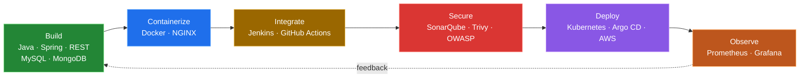

<div align="center">


<br>

<a href="https://www.linkedin.com/in/ayaan-bargir-13b684311/"></a>
<a href="mailto:ayaanbargir7@gmail.com"></a>
<a href="https://github.com/AyaanB24"></a>

</div>

---

<div align="center">

</div>

---

## Engineering Lifecycle



---

## Tech Stack

| Layer | Tools |
|---|---|
| **Backend** |  |
| **Data** |  |
| **Frontend basics** |  |
| **Containers & Orchestration** |  |
| **CI/CD** |  |
| **Cloud & OS** |  |
| **DevSecOps** |    |
| **Monitoring** |   |
| **Tools** |   |
| **Practices** | `Agile / Scrum` · `SDLC` · `OOPs` · `DBMS` · `Computer Networks` · `Operating Systems` · `REST APIs` |

---

## Experience &nbsp;`git log --career`

**Cloud Computing & DevOps Intern** · MainCrafts Technology *(Remote)* &nbsp;|&nbsp; `Jun 2026 – Jul 2026`
- Automated deployment of static websites on **AWS S3 + CloudFront** for secure, low-latency global delivery
- Containerized web applications using **Docker & NGINX**, deployed on **AWS EC2** for production hosting
- Built **CI/CD pipelines with GitHub Actions**, cutting manual build/deploy effort and improving release consistency

**Web Development Intern** · Rinex (Google for Education Partnership) *(Remote)* &nbsp;|&nbsp; `May 2025 – Jul 2025`
- Developed **REST APIs** and backend services for a full-stack Job Portal application
- Collaborated using **Git/GitHub** in an Agile development environment

**Web Development Intern** · Itinium *(Onsite)* &nbsp;|&nbsp; `Jun 2023 – Jul 2023`
- Developed frontend and backend components under mentor guidance
- Debugged code and collaborated with the team using Git, following industry-standard workflows

---

## Featured Projects

<table width="100%">
<tr>
<td width="50%" valign="top">

#### [Cloud-Native Job Portal](https://github.com/AyaanB24/job-portal-devops)
`Docker` `Jenkins` `SonarQube` `Kubernetes` `NGINX` &nbsp;·&nbsp; *Ongoing*

- Full-stack Job Portal with role-based auth, job management & tracking
- Containerized with Docker + NGINX — env setup cut from **30 min → under 5 min**
- CI/CD via Jenkins + GitHub webhooks + SonarQube — manual effort down **80%**
- In progress: Trivy, OWASP Dependency-Check, K8s deployment, Argo CD GitOps, Prometheus & Grafana

</td>
<td width="50%" valign="top">

#### [CI/CD Pipeline for Notes App](https://github.com/AyaanB24/k8s-Django-notes-app)
`Jenkins` `Docker` `Docker Compose`

- Jenkins pipeline cutting deployment time from **10 min → under 3 min**
- Automated Docker image publishing to Docker Hub
- Multi-container orchestration via Docker Compose
- Automated email alerts on failed builds for faster issue detection

</td>
</tr>
<tr>
<td width="50%" valign="top">

#### [QuMail — Quantum-Ready Secure Email](https://github.com/AyaanB24/Qumail)
`React` `FastAPI` `Shell Script` &nbsp;·&nbsp; *Hackathon Build*

- React frontend integrated with a FastAPI backend
- Multi-level encryption implemented for stronger data security
- One-script automated setup for full project execution

</td>
<td width="50%" valign="top">

#### Open-Source Contributions

- **3 merged PRs** (documentation) — [Tabler](https://github.com/tabler/tabler) and [MDN](https://github.com/mdn)
- Actively looking to contribute more to infra/DevOps-tooling repos

</td>
</tr>
</table>

---

## Education &nbsp;`cat education.log`

```text
[2024 – 2027]  B.Tech, Computer Science & Engineering (IoT & CSBT)
               Annasaheb Dange College of Engineering & Technology (ADCET), Ashta, India
               CGPA: 8.79

[2021 – 2024]  Diploma in Computer Science
               Lathe Polytechnic, Sangli, India
               Grade: 85.26%

[2020 – 2021]  SSC
               St. Thomas English Medium School, Sangli, India
               Grade: 82.20%
```

---

## Achievements & Certifications

  

| Recognition | Detail |
|---|---|
| **Best Presenter Award** (Software Category) + Finalist | ADCET National Level Hackathon S3 |
| **Finalist** | VishwaNova 2026 National Hackathon — top teams out of 3,000+ participants |
| **Qualified Round 2** (Idea Pitch) | Hack Elevate '26 National AI Hackathon — among 819+ participants |
| **Qualified Round 2** (Idea Presentation) | DIPEX 2026 Innovation Exhibition — among 3,000+ participants |

**Leadership & Speaking**
- **Team Lead**, VishwaNova Hackathon — led a team of 5, delegated tasks & coordinated timelines *(Mar 2026)*
- **Technical Speaker**, Coding Club — conducted Git & Docker sessions for juniors *(Feb 2024)*

---

## GitHub Analytics

<div align="center">


</div>

<div align="center">

</div>

<div align="center">

</div>

---

<div align="center">

### Let's Connect

<a href="https://www.linkedin.com/in/ayaan-bargir-13b684311/"></a>
<a href="mailto:ayaanbargir7@gmail.com"></a>
<a href="https://github.com/AyaanB24"></a>


</div>
